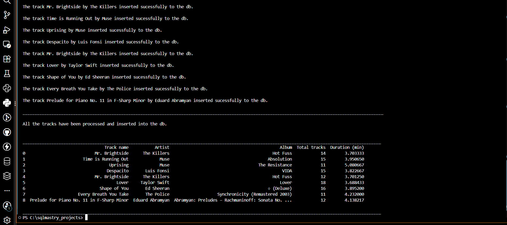
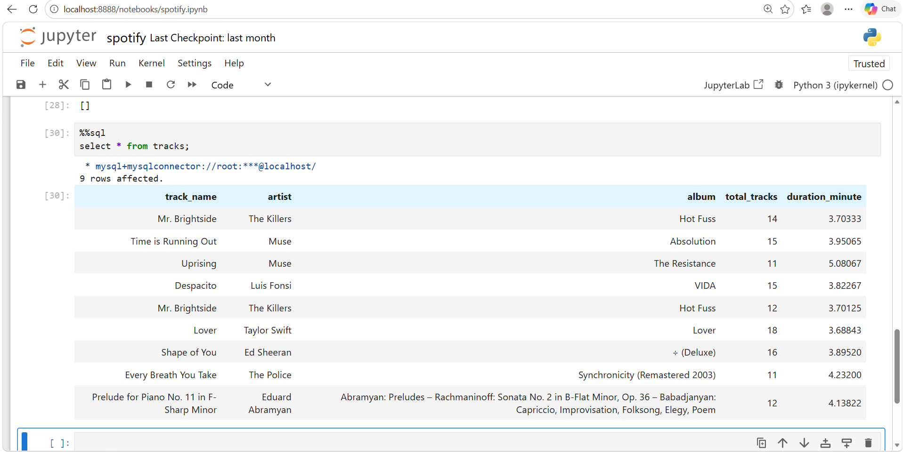
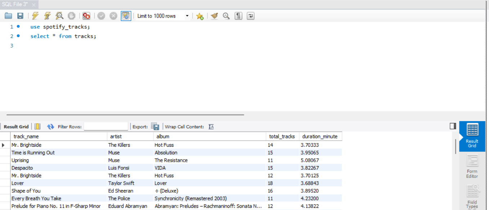
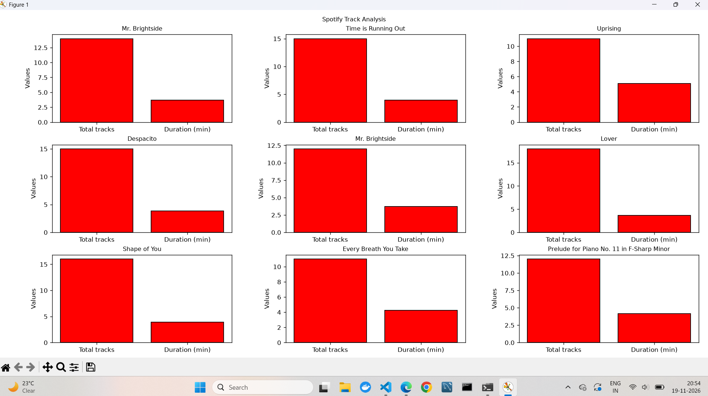

# 🎵 Spotify Track Analysis | Python • Spotify API • MySQL

A Python-based music data pipeline that retrieves track metadata from the **Spotify Web API**, stores the extracted information in **MySQL**, processes it with **Pandas**, exports a CSV dataset, and visualizes selected track and album details with **Matplotlib**.

---

## 📌 Project Overview

This project demonstrates an end-to-end workflow for collecting and working with real-world music metadata. Spotify track URLs are maintained in a text file. The application reads each URL, extracts its Spotify track ID using a regular expression, requests track details through the Spotipy library, and selects the required metadata.

The extracted records are inserted into a MySQL table. At the same time, the records are collected in Python and converted into a Pandas DataFrame. The DataFrame is displayed in tabular form and exported to a CSV file. Finally, Matplotlib creates a grid of bar charts for the processed tracks.

### What the project does

1. Reads Spotify track URLs from `track_urls.txt`.
2. Authenticates with Spotify using the Client Credentials flow.
3. Extracts each track ID and retrieves track metadata.
4. Inserts track information into MySQL.
5. Displays the processed records using Pandas.
6. Exports the dataset to CSV.
7. Creates a multi-panel Matplotlib visualization.

---

## ✨ Features

- **Spotify API integration** using Spotipy and Spotify Client Credentials.
- **Batch processing** of multiple track URLs from a text file.
- **Track metadata extraction**, including:
  - Track name
  - Artist name (first listed artist)
  - Album name
  - Total tracks in the album
  - Track duration in minutes
- **MySQL database storage** using `mysql.connector`.
- **Parameterized SQL INSERT statements** for inserting records.
- **Pandas DataFrame** for tabular data representation.
- **CSV export** for reuse in spreadsheet and analysis tools.
- **Matplotlib subplots** to visualize each processed track.
- **Error handling** so an individual URL failure is reported without silently stopping the loop.

---

## 🧰 Technology Stack

| Technology / Library | Role in the project |
|---|---|
| Python | Main programming language and workflow orchestration |
| Spotify Web API | Source of track and album metadata |
| Spotipy | Python client for Spotify API access |
| Regular Expressions (`re`) | Extracts the track ID from a Spotify URL |
| MySQL | Stores extracted track records |
| `mysql.connector` | Connects Python to MySQL |
| Pandas | Builds and displays the tabular dataset |
| Matplotlib | Generates bar-chart visualizations |
| `math` | Calculates the number of subplot rows |

---

## 🗂️ Repository Structure

```text
Spotify-Track-Analysis/
│
├── spotify_mysql.py
├── track_urls.txt
├── Spotify_track_analysis.csv
├── requirements.txt
├── README.md
│
└── screenshots/
    ├── code_output.png
    ├── jupyter_output.png
    ├── mysql_output.png
    ├── terminal_database_output.png
    └── graph_output.png
```

> The screenshot folder in this starter package contains the graph and terminal/database-insertion screenshots supplied for this README. Add your own `code_output.png`, `jupyter_output.png`, and `mysql_output.png` files when available. The README includes dedicated sections below so you can add them without changing the documentation structure.

---

## ⚙️ Setup and Installation

### 1. Clone the repository

```bash
git clone https://github.com/Tharika2004/Spotify-Track-Analysis.git
cd Spotify-Track-Analysis
```

### 2. Create and activate a virtual environment (recommended)

**Windows PowerShell**
```powershell
python -m venv venv
.\venv\Scripts\Activate.ps1
```

**macOS / Linux**
```bash
python3 -m venv venv
source venv/bin/activate
```

### 3. Install dependencies

Create a `requirements.txt` file containing:

```text
mysql-connector-python
spotipy
pandas
matplotlib
```

Then install:

```bash
pip install -r requirements.txt
```

### 4. Configure Spotify API credentials

1. Sign in to the [Spotify Developer Dashboard](https://developer.spotify.com/dashboard).
2. Create an application and obtain its Client ID and Client Secret.
3. Add the credentials to your local configuration.

The project uses Spotify's Client Credentials authentication:

```python
login = spotipy.Spotify(
    auth_manager=SpotifyClientCredentials(
        client_id="YOUR_SPOTIFY_CLIENT_ID",
        client_secret="YOUR_SPOTIFY_CLIENT_SECRET"
    )
)
```

**Security:** Never commit your Client Secret, access tokens, database password, or other credentials to GitHub. Prefer environment variables or a local `.env` file, and add `.env` to `.gitignore`.

### 5. Configure MySQL

Create a database and a table matching the fields used by the Python INSERT query. For example:

```sql
CREATE DATABASE spotify_analysis;

USE spotify_analysis;

CREATE TABLE tracks (
    id INT AUTO_INCREMENT PRIMARY KEY,
    track_name VARCHAR(255),
    artist VARCHAR(255),
    album VARCHAR(255),
    total_tracks INT,
    duration_minute DECIMAL(10, 6)
);
```

Update the connection configuration in your local Python script:

```python
db_config = {
    "host": "localhost",
    "user": "YOUR_MYSQL_USERNAME",
    "password": "YOUR_MYSQL_PASSWORD",
    "database": "spotify_analysis"
}
```

Adjust the database name and credentials to match your local MySQL setup.

### 6. Add Spotify track URLs

Add one Spotify track URL per line in `track_urls.txt`:

```text
https://open.spotify.com/track/3n3Ppam7vgaVa1iaRUc9Lp
```

You can add multiple track URLs, each on a separate line.

---

## ▶️ Run the Project

Run the Python script from the project directory:

```bash
python spotify_mysql.py
```

The script processes each non-empty URL, retrieves the metadata, inserts the record into MySQL, and prints a success or error message. After processing, it displays the DataFrame, exports the CSV file, and opens the Matplotlib chart window.

---

## 📸 Project Screenshots and Outputs

The screenshots below document the outputs available from the project run.

### 1. Python terminal output — API processing and database insertion

The terminal output shows successful processing messages for the selected tracks, followed by the tabular dataset displayed after extraction.



### 2. Jupyter Notebook output

Use this section to show the notebook cells and their outputs if you run or demonstrate the workflow in Jupyter Notebook.

**Add your screenshot:** save the image as `screenshots/jupyter_output.png`, then uncomment the Markdown image line below.



### 3. MySQL output — stored records

Use this section to show the records retrieved from your MySQL `tracks` table, for example using:

```sql
USE spotify_analysis;

SELECT
    track_name,
    artist,
    album,
    total_tracks,
    duration_minute
FROM tracks;
```


### 4. Matplotlib graph output — Spotify Track Analysis

The visualization creates one subplot for each processed track. Each chart compares the album's total track count with the selected song's duration in minutes.



### 5. Code screenshot

For a repository presentation, add a screenshot of the main Python script in VS Code. Save it as `screenshots/code_output.png`, then uncomment the line below.

---

## 📊 Data Fields and Visualization

| Field | Description |
|---|---|
| Track name | Name of the selected Spotify track |
| Artist | First artist listed for the track |
| Album | Album associated with the track |
| Total tracks | Total number of tracks in that album |
| Duration (min) | Track duration converted from milliseconds to minutes |

The chart currently plots **Total tracks** and **Duration (min)** together for each track. These values use different units, so the chart is best understood as a side-by-side display of two metadata fields, not as a direct like-for-like comparison.

---

## 📁 Generated Dataset

The processed records are exported to:

```text
Spotify_track_analysis.csv
```

The CSV contains the extracted track name, artist, album, total album track count, and duration in minutes. It can be opened in spreadsheet software or loaded into another Python analysis workflow.

---

## 🧠 Concepts Demonstrated

- API authentication and third-party API integration
- Reading text files and processing multiple inputs
- Regular-expression pattern matching
- Accessing nested JSON response fields
- Python exception handling
- MySQL connection, cursor execution, and transaction commits
- Parameterized SQL queries
- Pandas DataFrame creation and CSV export
- Matplotlib subplot creation and chart formatting

---

## 🔮 Future Improvements

- Prevent duplicate records by storing Spotify track IDs with a `UNIQUE` constraint.
- Move API and database credentials into environment variables.
- Add data validation for malformed or unavailable track URLs.
- Retrieve and analyze additional Spotify metadata where available through the API.
- Create artist-wise and album-wise summaries.
- Improve visualizations with separate charts or normalized metrics.
- Build an interactive dashboard using Streamlit.
- Add logging and automated tests for more reliable processing.

---

## ⚠️ Notes and Limitations

- The current script uses the first artist in the Spotify track response.
- The current database INSERT statement does not include a Spotify track ID, so repeated URLs can create duplicate rows.
- The current visualization compares two different units: album track count and song duration.
- Spotify API access and returned fields are subject to Spotify's API policies and application permissions.
- This repository is an educational project demonstrating API-based data extraction, database storage, processing, and visualization.

---

## 👩‍💻 Author

THARIKA D

- GitHub: [My GitHub Profile](https://github.com/Tharika2004)
- LinkedIn: [My LinkedIn Profile](https://www.linkedin.com/in/tharika-d/)

---

## ⭐ Acknowledgement

Thanks to Spotify for providing the Web API and developer resources used to explore music metadata.

If you find this project useful, feel free to ⭐ the repository!
